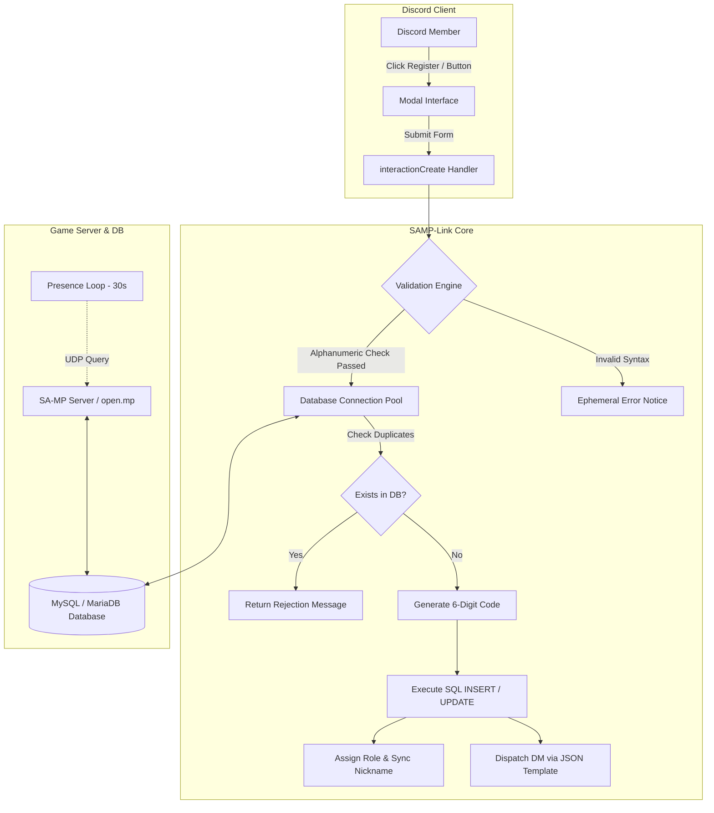

<div align="center">

<pre>
  /$$$$$$   /$$$$$$  /$$      /$$ /$$$$$$$         /$$       /$$           /$$      
 /$$__  $$ /$$__  $$| $$$    /$$$| $$__  $$       | $$      |__/          | $$      
| $$  \__/| $$  \ $$| $$$$  /$$$$| $$  \ $$       | $$       /$$ /$$$$$$$ | $$   /$$
|  $$$$$$ | $$$$$$$$| $$ $$/$$ $$| $$$$$$$//$$$$$$| $$      | $$| $$__  $$| $$  /$$/
 \____  $$| $$__  $$| $$  $$$| $$| $$____/|______/| $$      | $$| $$  \ $$| $$$$$$/ 
 /$$  \ $$| $$  | $$| $$\  $ | $$| $$             | $$      | $$| $$  | $$| $$_  $$ 
|  $$$$$$/| $$  | $$| $$ \/  | $$| $$             | $$$$$$$$| $$| $$  | $$| $$ \  $$
 \______/ |__/  |__/|__/     |__/|__/             |________/|__/|__/  |__/|__/  \__/
</pre>

### ⚡ Next-Generation SA-MP & Discord Synchronization Gateway ⚡

<p align="center">
  <a href="https://github.com/ikyyxzdev/samp-link/stargazers"></a>
  <a href="https://github.com/ikyyxzdev/samp-link/network/members"></a>
  <a href="https://github.com/ikyyxzdev/samp-link/issues"></a>
  <a href="https://github.com/ikyyxzdev/samp-link/blob/main/LICENSE"></a>
</p>

<p align="center">
  
</p>

<p align="center">
  <b>Enterprise-grade Discord.js v14 bot bridge seamlessly interfacing Discord communities with San Andreas Multiplayer (SA-MP / open.mp) MySQL gamemode databases.</b>
</p>

---

</div>

## 📑 Table of Contents

- [Overview](#-overview)
- [Key Features](#-key-features)
- [Architecture & Tech Stack](#-architecture--tech-stack)
- [Directory Layout](#-directory-layout)
- [Prerequisites](#-prerequisites)
- [Step-by-Step Installation](#-step-by-step-installation)
- [Configuration Matrix (.env)](#-configuration-matrix-env)
- [Database Schema Contract](#-database-schema-contract)
- [Commands & Interactive Components](#-commands--interactive-components)
- [Decoupled UI Copy & Templates](#-decoupled-ui-copy--templates)
- [Production Deployment & PM2](#-production-deployment--pm2)
- [Troubleshooting & Common Pitfalls](#-troubleshooting--common-pitfalls)
- [Star History & Growth](#-star-history--growth)
- [License & Acknowledgments](#-license--acknowledgments)

---

## 🌐 Overview

**SAMP-Link** eliminates friction between SA-MP game servers and Discord communities. Instead of manual account creation, website signups, or staff intervention, **SAMP-Link** empowers players to self-register UCP accounts via native Discord Modals, validates inputs against SQL injection and duplicate constraints, automatically writes directly to your MySQL/MariaDB database, delivers verification codes straight to user DMs, updates guild nicknames, and syncs roles instantly.

---

## 🚀 Key Features

* **🎛️ Full User Control Panel (/panelucp)**
  * Persistent interactive message embed with dynamic button controls.
  * Native Discord Modal input with strict validation: minimum 4 alphanumeric characters, no spaces, no special characters, and numbers-only prevention.
  * **1 Discord Account = 1 UCP Constraint** to eliminate multi-account abuses.
* **🔁 Autonomous Account Self-Service**
  * **📩 Resend Code:** Dispatches a fresh 6-digit random verification code directly to user DMs without resetting credentials.
  * **🛡️ ReVerify Role:** Instant restoration of `UCP_ROLE` and nickname formatting (`Verified - Username`) if members accidentally leave or lose sync.
  * **🔑 Password Reset:** Safely purges password and salt hashes, instantly issuing a new 6-digit verification code to re-link or complete setup in-game.
* **📡 Real-Time UDP Telemetry & Presence Engine**
  * Built-in socket query wrapper pulling server hostname, player count, gamemode, and map name via UDP (`samp-query`).
  * Continuous bot activity synchronization every 30 seconds (`Listening to Server Name | X/Y Players`).
  * Automatic failover state: switches bot presence to `Server Offline` with DND (Do Not Disturb) status if the server becomes unreachable.
* **📊 Monospace Paginated Player Directory (/players)**
  * Renders connected players in aligned monospace tables (`ID | Player Name | Score | Ping`).
  * Interactive paginated buttons (`Previous`, `Next`, `Refresh`) with automatic 60-second expiration.
* **⚙️ Decoupled Text Architecture**
  * All user-facing text, embed colors, button emojis, and DM notices are isolated inside JSON configuration files (`src/text/`). Modify bot copy without touching application code.

---

## 🛠️ Architecture & Tech Stack

<div align="center">

| Technology | Badge | Purpose |
| :--- | :--- | :--- |
| **Node.js** |  | Runtime Engine |
| **Discord.js v14** |  | Discord Gateway Client |
| **MySQL2 / MariaDB** |  | Connection Pool & Query Executor |
| **samp-query** |  | Game Server Socket Telemetry |
| **Dotenv** |  | Environment Variable Management |

</div>



---

## 📂 Directory Layout

```text
samp-link/
├── src/
│   ├── commands/                    # Application Slash Commands
│   │   ├── admin/
│   │   │   └── panelucp.js          # Founder-only deployment of the UCP panel
│   │   ├── player/
│   │   │   └── ping.js              # Real-time WebSocket & API latency probe
│   │   └── server/
│   │       ├── players.js           # Paginated live player list table
│   │       └── serverinfo.js        # Server metrics, IP, and status widget
│   ├── config/
│   │   └── index.js                 # Centralized configuration mapping & defaults
│   ├── database/
│   │   └── index.js                 # MySQL2 pooled connection & query helpers
│   ├── events/
│   │   ├── client/
│   │   │   └── ready.js             # Client lifecycle & 30s presence polling loop
│   │   └── guild/
│   │       └── interactionCreate.js # Unified router for Slash, Buttons & Modals
│   ├── handlers/
│   │   ├── commandHandler.js        # Recursive command loader & REST deployer
│   │   └── eventHandler.js          # Dynamic event subscriber
│   ├── text/                        # Decoupled JSON templates for bot copy
│   │   ├── registerdm.json          # Welcome DM verification dispatch
│   │   ├── registerucp.json         # Main registration panel visual copy
│   │   ├── resendcodedm.json        # Resent code DM template
│   │   └── resetpassworddm.json     # Password wipe & recovery DM template
│   ├── utils/
│   │   └── sampQuery.js             # Promise-wrapped UDP query client
│   └── index.js                     # System bootstrap entry point
├── .env.example                     # Environment configuration blueprint
├── package.json                     # Dependency manifests & npm scripts
└── README.md                        # Documentation
```

---

## 📦 Prerequisites

Before deploying **SAMP-Link**, ensure your environment meets the following specifications:

1. **Node.js**: v18.0.0 or higher (https://nodejs.org/).
2. **Database Engine**: MySQL 5.7+ or MariaDB 10.3+ (https://mariadb.org/).
3. **SA-MP / open.mp Server**: Live server instance with query enabled (`query 1` in your `server.cfg`).
4. **Discord Developer Application**: A registered bot token with **Privileged Gateway Intents** enabled:
   * `SERVER MEMBERS INTENT` (Required for assigning roles and updating member nicknames)
   * `MESSAGE CONTENT INTENT`

---

## 📥 Step-by-Step Installation

### 1. Clone Repository
```bash
git clone https://github.com/ikyyxzdev/samp-link.git
cd samp-link
```

### 2. Install Project Dependencies
```bash
npm install
```

### 3. Setup Configuration
Duplicate the environment template and configure your parameters:
```bash
cp .env.example .env
```

### 4. Verify Database Connectivity & Launch
```bash
npm start
```
The application will verify MySQL connectivity, dynamically register slash commands with Discord REST API, and initiate UDP server monitoring.

---

## ⚙️ Configuration Matrix (.env)

| Variable | Required | Default | Description |
| :--- | :---: | :---: | :--- |
| `DISCORD_TOKEN` | **Yes** | — | Secret authentication token from Discord Developer Portal. |
| `CLIENT_ID` | **Yes** | — | Discord Application ID. |
| `GUILD_ID` | **Yes** | — | Discord Server ID for instant command deployment. |
| `BOT_NAME` | No | `SA-MP Link` | Public brand name of your bot / gateway. |
| `LOGO_LINK` | No | `null` | Direct URL to thumbnail image (PNG/JPG). |
| `BANNER_LINK` | No | `null` | Direct URL to wide banner image. |
| `SERVER_IP` | **Yes** | `127.0.0.1:7777` | Game server IP and port formatted as `HOST:PORT`. |
| `FOUNDER_ROLE` | **Yes** | — | Role ID allowed to deploy `/panelucp`. |
| `ADMIN_ROLE` | No | — | Role ID for administrative operations. |
| `UCP_ROLE` | **Yes** | — | Role ID automatically granted upon successful registration. |
| `NAME_AFTER_REGISTER`| No | `Verifed` | Prefix added to player nicknames (`{PREFIX} - {UCP}`). |
| `DB_HOST` | **Yes** | `127.0.0.1` | MySQL/MariaDB server host. |
| `DB_PORT` | No | `3306` | MySQL/MariaDB service port. |
| `DB_USER` | **Yes** | `root` | Database username. |
| `DB_PASSWORD` | **Yes** | — | Database user password. |
| `DB_NAME` | **Yes** | `samp_database` | Target database containing your gamemode tables. |
| `TABLE_UCP` | **Yes** | `players` | Table storing player account records. |
| `COLUMN_ID` | **Yes** | `id` | Primary key column identifier. |
| `COLUMN_NAME_UCP` | **Yes** | `ucp_name` | Column storing the unique UCP username. |
| `COLUMN_VERIFY_CODE`| **Yes** | `verify_code` | Column storing the 6-digit verification code. |
| `COLUMN_DISCORD_ID` | **Yes** | `discord_id` | Column storing the linked Discord user snowflake ID. |
| `COLUMN_PASSWORD` | No | `password` | Column storing password hash (cleared on reset). |
| `COLUMN_SALT` | No | `salt` | Column storing salt hash (cleared on reset if populated). |

---

## 🗄️ Database Schema Contract

SAMP-Link dynamically binds to your existing gamemode tables via configured column identifiers. If your table is missing the required columns, execute the following SQL migration on your database:

```sql
ALTER TABLE `players`
  ADD COLUMN IF NOT EXISTS `ucp_name` VARCHAR(24) NOT NULL UNIQUE,
  ADD COLUMN IF NOT EXISTS `verify_code` VARCHAR(6) NULL DEFAULT NULL,
  ADD COLUMN IF NOT EXISTS `discord_id` VARCHAR(32) NULL UNIQUE DEFAULT NULL,
  ADD COLUMN IF NOT EXISTS `password` VARCHAR(255) NOT NULL DEFAULT '',
  ADD COLUMN IF NOT EXISTS `salt` VARCHAR(128) NULL DEFAULT '';
```

---

## 🎮 Commands & Interactive Components

<div align="center">

| Command | Type | Authorization | Details |
| :--- | :---: | :---: | :--- |
| `/panelucp` | Slash | `Founder Role` / Server Owner | Posts the primary self-service registration and account management panel. |
| `/serverinfo`| Slash | `@everyone` | Live query widget showing online players, hostname, gamemode, and map name. |
| `/players` | Slash | `@everyone` | Paginated directory of active players formatted in a clean monospace table. |
| `/ping` | Slash | `@everyone` | Real-time diagnostic evaluating WebSocket ping and gateway round-trip time. |

</div>

### Component Action Triggers
* **`Register UCP` Button:** Pops up a native Discord modal prompt requesting the desired UCP username.
* **`Resend Code` Button:** Locates the player's account by their Discord ID, refreshes the 6-digit code in the database, and delivers it via DM.
* **`ReVerify Role` Button:** Re-evaluates linked status, re-assigns `UCP_ROLE`, and syncs their guild nickname.
* **`Reset Password` Button:** Wipes existing password/salt hashes from the database and issues a fresh recovery code via DM.

---

## 📝 Decoupled UI Copy & Templates

Modify all public-facing text, button labels, embed layouts, and DM dispatches without altering Node.js scripts:

* **`src/text/registerucp.json`**: Embed title, description, rules, guidance fields, and button labels for the main `/panelucp` interface.
* **`src/text/registerdm.json`**: Direct Message notification delivered with the initial 6-digit verification code.
* **`src/text/resendcodedm.json`**: Direct Message notification delivered when a user requests a code resend.
* **`src/text/resetpassworddm.json`**: Direct Message security notification dispatched upon password reset requests.

### Supported Template Placeholders:
* `{BOT_NAME}`: Evaluates to `config.bot.name`.
* `{USER_TAG}`: Evaluates to the user's Discord handle (e.g., `Username#0000` or `@username`).
* `{UCP_NAME}`: Evaluates to the registered UCP account name.

---

## 🚀 Production Deployment & PM2

For 24/7 background operation on production Linux or Windows VPS environments, run SAMP-Link using [PM2 Process Manager](https://pm2.keymetrics.io/):

```bash
# Install PM2 globally
npm install -g pm2

# Launch bot instance with automated restart protection
pm2 start src/index.js --name "samp-link"

# Configure PM2 to start on system boot
pm2 startup
pm2 save

# Monitor live logs and memory utilization
pm2 logs samp-link
pm2 status
```

---

## ⚠️ Troubleshooting & Common Pitfalls

### 1. DiscordAPIError[50013]: Missing Permissions
* **Cause:** The bot's role in your Discord server is positioned **lower** than the `UCP_ROLE` or the member it is trying to rename.
* **Solution:** Navigate to **Server Settings** ➔ **Roles**, and drag your Bot's role to the top of the hierarchy (above `UCP_ROLE`). Note that Discord forbids bots from renaming Server Owners.

### 2. ER_PARSE_ERROR: You have an error in your SQL syntax near '?'
* **Cause:** MariaDB / MySQL server-side prepared statements do not allow parameter placeholders (`?`) for table or column identifiers.
* **Solution:** Ensure you are using the latest `samp-link` codebase where table and column names are interpolated with backticks (`` ` ``) and only user inputs are parameterized.

### 3. Cannot send messages to this user (DM Closed)
* **Cause:** The user has disabled Direct Messages from server members in their Discord Privacy & Safety settings.
* **Solution:** SAMP-Link captures this exception gracefully and warns the user via an ephemeral response to enable direct messages.

---

## 📈 Star History & Growth

<div align="center">
  <a href="https://star-history.com/#ikyyxzdev/samp-link&Date">
    <picture>
      <source media="(prefers-color-scheme: dark)" srcset="https://api.star-history.com/svg?repos=ikyyxzdev/samp-link&type=Date&theme=dark" />
      <source media="(prefers-color-scheme: light)" srcset="https://api.star-history.com/svg?repos=ikyyxzdev/samp-link&type=Date" />
      
    </picture>
  </a>
</div>

---

## 📄 License & Acknowledgments

Distributed under the **MIT License**. See `LICENSE` for complete terms and permissions.

<div align="center">

Crafted with dedication by **[ikyyxzdev](https://github.com/ikyyxzdev)**  
*Building open-source tools for the San Andreas Multiplayer community.*

[⬆ Back to Top](#-next-generation-sa-mp--discord-synchronization-gateway-)

</div>